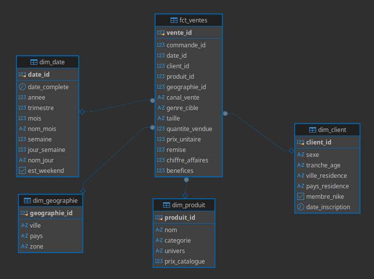

# Fiche projet – Ventes Nike

**Groupe :** Ashley Waynell Tagne Negueko, Saïdou Coumaré, Eli Moktar, Michel Guy  
**Jour :** J1

---

## Sujet

Analyse des ventes Nike dans le monde entre 2023 et 2025.

**Question métier :** quels produits, quels marchés et quel canal de vente (en ligne ou en magasin) rapportent le plus à Nike, et comment les ventes évoluent-elles au fil des mois ?

---

## Source et licence

- **Source :** [Nike Sales Dataset – Kaggle](https://www.kaggle.com/datasets/nayakganesh007/nike-sales-uncleaned-dataset)
- **Licence :** CC0 (domaine public) — données fictives

Le fichier de départ contient 2 500 lignes, mais il était assez sale : dates dans plusieurs formats, noms de villes incohérents, Order_ID en doublon, valeurs manquantes, et pas mal de lignes avec un chiffre d'affaires à 0. On l'a nettoyé et découpé en plusieurs tables.

Comme les données ne couvrent que l'Inde, on a généré des commandes sur les autres marchés de Nike en respectant la répartition de son CA 2025 par zone (North America ~44 %, EMEA ~27 %, Greater China ~15 %, APLA ~14 %). Tous les montants sont en dollars.

---

## Critères de la base

| Critère | Ce qu'on a fait |
|---|---|
| Tables reliées | Schéma en étoile : `fait_ventes` au centre, 4 dimensions autour |
| Dimension temporelle | `dim_date` — calendrier de juillet 2023 à juillet 2025 |
| Catégories / groupes | Catégorie et univers produit, genre (Men/Women/Kids), canal (Online/Retail), zone, pays, ville, tranche d'âge |
| Hiérarchie | Table `categories` : Nike → univers → catégorie → produit, parcourue via une CTE récursive |
| Volume | 147 588 ventes, 25 000 clients. Un script Python permet de monter à ~10 millions de lignes pour tester les perfs |
| Licence | CC0 |

---

## Tables et volumes

| Table | Contenu | Lignes |
|---|---|---|
| `fait_ventes` | Une ligne par produit vendu : quantité, prix unitaire, remise, CA, bénéfices | 147 588 |
| `dim_date` | Calendrier : année, trimestre, mois, jour de semaine, week-end | 762 |
| `dim_client` | Sexe, tranche d'âge, ville de résidence, membre Nike, date d'inscription | 25 000 |
| `dim_produit` | Nom du produit, catégorie, univers, prix catalogue | 20 |
| `dim_geographie` | Ville, pays, zone | 47 |
| `categories` | Hiérarchie du catalogue (pour la CTE récursive uniquement) | 28 |

---

## Environnement

PostgreSQL installé en local.

---

## Schéma en étoile



> La table `categories` n'apparaît pas sur le schéma : elle n'est pas reliée à l'étoile, elle sert uniquement à la CTE récursive.

---

## 3 requêtes SQL

### 1. CA par ville — uniquement les villes au-dessus de 500 000 $

On joint `fait_ventes` avec `dim_geographie` pour regrouper par ville et filtrer avec `HAVING`.

```sql
SELECT g.ville,
       g.pays,
       COUNT(DISTINCT f.commande_id) AS nb_commandes,
       SUM(f.chiffre_affaires)       AS ca
FROM fait_ventes f
JOIN dim_geographie g ON g.geographie_id = f.geographie_id
GROUP BY g.ville, g.pays
HAVING SUM(f.chiffre_affaires) > 500000
ORDER BY ca DESC;
```

---

### 2. CA et bénéfices par zone et par canal de vente

Permet de voir si le online ou le retail domine selon la zone géographique.

```sql
SELECT g.zone,
       f.canal_vente,
       SUM(f.chiffre_affaires) AS ca,
       SUM(f.benefices)        AS benefices
FROM fait_ventes f
JOIN dim_geographie g ON g.geographie_id = f.geographie_id
GROUP BY g.zone, f.canal_vente
ORDER BY ca DESC;
```

---

### 3. CA par univers de produit et par trimestre

Utile pour suivre la saisonnalité selon la gamme de produits (Running, Lifestyle, etc.).

```sql
SELECT d.annee,
       d.trimestre,
       p.univers,
       SUM(f.quantite_vendue)  AS unites_vendues,
       SUM(f.chiffre_affaires) AS ca
FROM fait_ventes f
JOIN dim_date    d ON d.date_id    = f.date_id
JOIN dim_produit p ON p.produit_id = f.produit_id
GROUP BY d.annee, d.trimestre, p.univers
ORDER BY d.annee, d.trimestre, p.univers;
```
